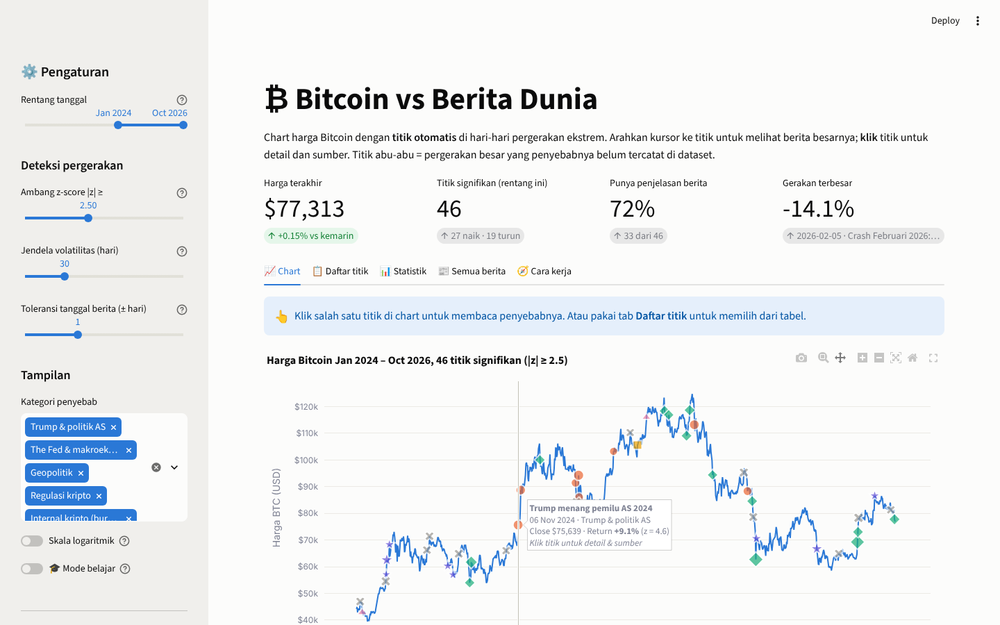
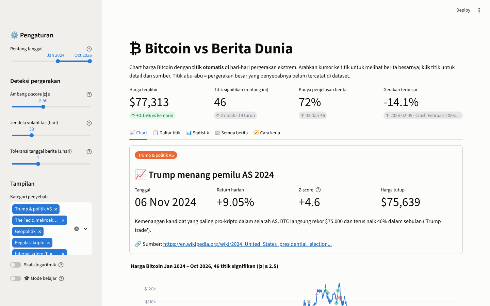
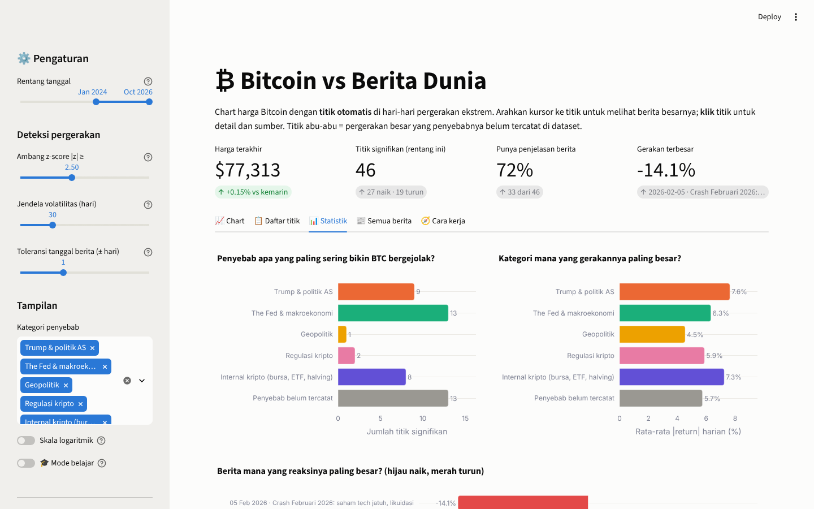
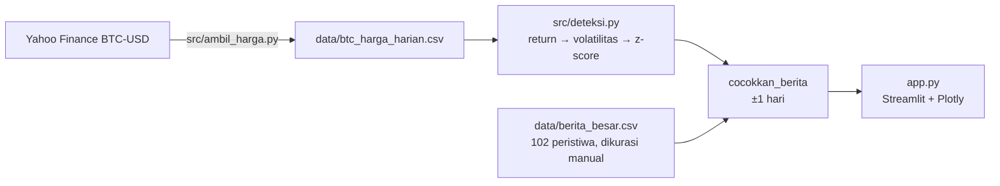

# ₿ Bitcoin vs Berita Dunia

> Chart interaktif harga Bitcoin yang **otomatis menandai hari-hari bergejolak**, lalu memasangkannya dengan
> berita besar dunia: pernyataan Trump, keputusan The Fed, perang, regulasi, sampai bursa kripto yang bangkrut.
> Arahkan kursor ke titik untuk lihat penyebabnya, klik untuk detail dan sumber.
> Dibangun dengan Python, pandas, Plotly, dan Streamlit.

*An interactive Bitcoin price chart that auto-detects abnormal daily moves (rolling z-score) and links each
one to a curated dataset of major world events, with sources. Built with Python, pandas, Plotly and Streamlit.*

**🚀 Coba langsung di browser:** [btc-news-volatility.streamlit.app](https://btc-news-volatility.streamlit.app)



## Kenapa project ini ada?

Setiap kali harga Bitcoin melonjak atau anjlok, lini masa penuh orang yang "tahu" penyebabnya: Trump membuat pernyataan,
The Fed naikkan bunga, ada perang. Tapi klaim itu jarang dicek balik ke data. Project ini mencoba menjawabnya
secara sistematis:

1. **Hari mana saja** harga Bitcoin bergerak jauh di luar kebiasaannya?
2. **Ada berita besar apa** di hari-hari itu?
3. **Kategori berita mana** yang paling sering, dan paling besar, menggoyang harga?
4. Berapa banyak gerakan besar yang **tidak** punya penjelasan berita yang jelas?

Hasilnya bukan ramalan harga, tapi alat untuk membaca hubungan antara berita dan pasar dengan lebih jujur.

## Fitur

| Tab | Isi |
|---|---|
| 📈 Chart | Garis harga + titik berwarna per kategori penyebab. Hover = ringkasan berita, klik = kartu detail + link sumber. Ukuran titik mengikuti seberapa ekstrem gerakannya |
| 📋 Daftar titik | Tabel semua pergerakan signifikan di rentang yang dipilih, bisa diurutkan dan diunduh CSV |
| 📊 Statistik | Jumlah titik per kategori, rata-rata besar gerakan per kategori, 15 berita dengan reaksi terbesar, jumlah hari ekstrem per tahun |
| 📰 Semua berita | 102 peristiwa 2020–2026 beserta reaksi harga di hari itu, walau kecil |
| 🧭 Cara kerja | Diagram alur data, sumber, dan daftar keterbatasan |
| 🎓 Mode belajar | Toggle di sidebar: tiap grafik dapat penjelasan rumus + potongan kode |

Semua parameter deteksi (ambang z-score, jendela volatilitas, toleransi tanggal) bisa digeser lewat slider dan
seluruh dashboard langsung dihitung ulang.




## Cara menjalankan

```bash
git clone https://github.com/Avalon2222/btc-news-volatility.git
cd btc-news-volatility
python -m venv .venv && source .venv/bin/activate   # Windows: .venv\Scripts\activate
pip install -r requirements.txt
streamlit run app.py
```

Buka `http://localhost:8501`. Jalankan tes dengan `python -m pytest tests/ -v`.
Perbarui data harga dengan `python -m src.ambil_harga` (atau tombol di sidebar).

## Cara kerja (ringkas)



Inti deteksinya tiga baris pandas:

```python
df["return_pct"]      = df["close"].pct_change() * 100                      # % perubahan dari kemarin
df["volatilitas_pct"] = df["return_pct"].rolling(30).std().shift(1)         # gejolak "normal" 30 hari sebelumnya
df["z_score"]         = df["return_pct"] / df["volatilitas_pct"]            # berapa kali lipat dari normal?
titik = df[df["z_score"].abs() >= 2.5]
```

Kenapa z-score dan bukan sekadar "turun 5%"? Karena 5% di 2020 itu hari biasa, sedangkan 5% di 2025 itu
berita utama. Z-score menyesuaikan ambang dengan kondisi pasar saat itu. Penjelasan lengkap ada di
[docs/BELAJAR.md](docs/BELAJAR.md).

## Temuan menarik (ambang |z| ≥ 2,5, 2020–Okt 2026)

- Ada **104 hari** dengan pergerakan ekstrem dari 2.496 hari data; **sekitar 77%** di antaranya bisa
  dipasangkan dengan berita besar di dataset.
- Kategori **The Fed & makroekonomi** paling sering muncul: Bitcoin bergerak searah dengan saham teknologi
  AS jauh lebih sering daripada yang diduga narasi "emas digital".
- Gerakan harian terbesar sejak 2020 tetap **crash COVID 12 Maret 2020 (−37%)**. Di era ETF (2024+)
  gerakan ekstrem jarang lebih dari ±10%, tapi **likuidasi** jadi penguat utama: 10 Oktober 2025
  (ancaman tarif 100% ke China) dan 5 Februari 2026 (crash saham tech) keduanya diperbesar oleh posisi
  leverage yang dipaksa tutup.
- Banyak berita "besar" ternyata **tidak** menggerakkan harga, misalnya halving 2024 dan pemangkasan bunga
  September 2025: pasar sudah menghitungnya duluan (*priced in*).

Angka di atas berubah kalau slider digeser, dan itu memang tujuannya.

## Struktur folder

```
btc-news-volatility/
├── app.py                  # dashboard Streamlit (tampilan)
├── src/
│   ├── ambil_harga.py      # unduh harga dari Yahoo Finance
│   ├── muat_data.py        # baca + validasi CSV
│   └── deteksi.py          # return, volatilitas, z-score, pencocokan berita
├── data/
│   ├── btc_harga_harian.csv
│   ├── berita_besar.csv    # dataset berita, mudah ditambah
│   └── SUMBER_DATA.md
├── tests/test_deteksi.py
└── docs/
    ├── BELAJAR.md          # panduan belajar langkah demi langkah
    ├── LATIHAN.md          # 9 latihan bertingkat
    └── screenshots/
```

## Keterbatasan

- **Korelasi bukan sebab-akibat.** Berita yang berdekatan tanggalnya adalah penjelasan yang paling masuk akal,
  bukan bukti. Sering ada beberapa faktor sekaligus.
- Dataset berita dikurasi manual dan bisa bias ke berita berbahasa Inggris yang terkenal. Titik abu-abu
  menandai gerakan besar yang belum ada catatannya.
- Harga harian menyembunyikan flash crash yang pulih di hari yang sama.
- Bukan saran investasi.

## Lisensi

MIT. Data harga milik Yahoo Finance; dataset berita boleh dipakai ulang dengan menyebut repo ini.
